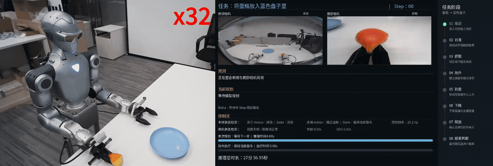

<a id="chinese"></a>

[中文](#chinese) | [English](#english)

# GPT-6 Astra 控制 Unitree R1-A7

本仓库提供基于视觉反馈的 R1-A7 右臂 pick-and-place 控制实验。Astra 每轮只负责根据新观测提出一个局部意图；本地控制栈负责状态接管、确定性安全检查、IK、插值下发和执行结果验证。系统不向模型开放关节级控制，也不把一串预测动作当作已执行轨迹。

## Demo

完整 pick-and-place 过程：接近目标、对准抓取、闭合夹爪、抬升搬运、移动至目标区域并释放。



[查看高清 MP4 原视频](agent/docs/demo.mp4)

## 控制闭环

```text
操作员确认机器人处于调试状态
  → 只读检查相机 / DDS 状态并建立当前指令快照
  → 控制器接管右臂；左臂、头部、腰和底盘保持
  → 获取动作完成后的新 head_right / wrist_right 图像与状态
  → Astra 生成一个右末端局部目标
  → 本地校验观测新鲜度、变化幅度、工作空间、IK、关节限位和自碰撞
  → 右臂插值下发；等待实测反馈稳定
  → 记录动作前后证据，再获取新观测进入下一轮
```

关键约束：`requested != measured`，控制器的持续指令状态与传感器实测状态分开保存；推理等待期间不外推动作；每个动作后必须使用新图；异常时锁存保持，不盲目继续或自动回零。

当前 Direct 路径先完成稳定 pre-grasp，只有显式启用抓取阶段时才执行闭合、试抬和视觉跟随验证。放置完成必须由释放后的新观测确认，不能仅凭夹爪命令推断成功。具体阶段门控及尚未硬件验证的边界见 [rollout 文档](agent/docs/astra_grasp_rollout.md)。

## Rollout 指南

本仓库有两种上层 rollout 接口，共享部分机器人底层，但决策格式、状态管理和运行入口不同：

| 路径 | 适用场景 | 决策与状态 | 详细说明 |
|---|---|---|---|
| Direct EEF | 直接根据视觉提出右末端目标，适合逐步验证视觉伺服与 pre-grasp | 单个 EEF 目标；DirectPhase 管理 head/wrist 切换和稳定 pre-grasp，同一进程负责锁存保持/明确恢复 | [Direct 闭环、接管与执行细节](agent/docs/astra_grasp_rollout.md) |
| SDK / AgP | 通过统一 observation/action 接口执行带 capture 绑定和任务门闩的 pick-and-place | `move`、`close`、`open`、`observe`、`done`、`stop` 等离散 action；SDK 保存抓取/放置阶段状态 | [SDK 接口与最小循环](agent/docs/r1a7_sdk.md) |

两条路径的单轮闭环相同：动作完成后获取新观测，形成单步提案，由本地执行层校验，再下发并验证反馈。SDK / AgP 额外把 observation 的 capture 与动作绑定，防止旧图被重复用于运动；Direct 路径使用自己的 frame id、阶段状态和场景变化检查。不要把两种入口的 action schema 或接管方式混用。

SDK / AgP 的任务门槛按证据推进：

| 阶段 | 继续条件 |
|---|---|
| 接近与对准 | 新图中目标、右手及短动作路径清楚；靠近接触时缩小步幅 |
| 闭合 | 目标抓取区域位于两指之间，且大致与指尖同高 |
| 试抬 | 闭合后的首个移动为不超过 3 mm 的纯 `+Z` |
| 搬运 | 试抬后的新图确认目标随手移动 |
| 释放 | 目标已受支撑并位于目标盘内；空爪按失败分支处理 |
| 完成 | 释放后的新图确认目标仍在盘内且已离开夹爪 |

策略 proposal 不代表动作已执行；只把已完成动作和动作后观测写入 rollout 记录。遇到目标/手丢失、路径不清、观测过期、IK/限位/碰撞检查失败或证据不一致时应保持并等待人工处理，不自动回 home 或盲目重试。机器人自碰撞检查不提供桌面及外部环境的碰撞保证。

使用本仓库 SDK 时，可先检查 schema、状态和观测，再运行 dry-run：

```bash
python agent/scripts/r1a7_sdk.py --session agp/sessions/r1_trial schema
python agent/scripts/r1a7_sdk.py --session agp/sessions/r1_trial status
python agent/scripts/r1a7_sdk.py --session agp/sessions/r1_trial observe
python agent/scripts/astra_sdk_rollout.py --session agp/sessions/r1_trial --dry-run
```

独立的 `agent-as-policy/agp` server/runner 位于该项目自身仓库，部署命令依其代码和运行环境为准。本仓库 SDK 的 `sdk_episode/steps.jsonl` 对齐动作前观测、提案、执行结果和动作后观测；`recipe.jsonl` 只记录实际执行动作用于复盘，不应盲目重放为绝对轨迹。旁观录制不作为策略输入。

## 代码结构

| 路径 | 职责 |
|---|---|
| `agent/scripts/astra_direct_rollout.py` | 当前 Direct EEF 视觉闭环主入口 |
| `agent/astra_direct_policy.py` | 单步目标结构、视角阶段与策略安全包络 |
| `agent/astra_robot.py` | 右臂 FK/IK、碰撞检查、动作执行与反馈 |
| `agent/astra_grasp_stage.py` | 闭合、试抬及抓取证据验证 |
| `agent/r1a7_sdk/`、`agent/scripts/astra_sdk_rollout.py` | 独立的 SDK / Agent-as-Policy 接口路径 |
| `teleop/`、`robot/` | 复用的图像订阅、IK、DDS、夹爪和机器人模型 |

原有遥操入口仍在 `scripts/teleop_real.py`、`scripts/teleop_sim.py`；自主 rollout 复用其底层控制模块，不需要把遥操入口当作 Astra 策略运行。

## 运行入口

环境准备：

```bash
bash setup.sh
conda activate r1_teleop
export LD_LIBRARY_PATH="$CONDA_PREFIX/lib:$LD_LIBRARY_PATH"
```

机器人端需按部署方式启动 PC2 图像及夹爪服务。操作员须先确认 R1-A7 已处于调试模式；程序不会替操作员切换机器人 FSM。

只读检查（不发布机械臂或夹爪命令）：

```bash
python agent/scripts/astra_grasp_rollout.py --probe --net enp5s0
```

Direct 路径先做单步 dry-run，检查提案和本地安全校验，不执行动作：

```bash
python agent/scripts/astra_direct_rollout.py --net enp5s0 --view-dir agent/logs/agp_r1a7_view
```

真机运行需要显式启用运动和 Dex1；接管要求、观察步骤及抓取阶段详见 [rollout 文档](agent/docs/astra_grasp_rollout.md)。建议先启动只读预览：

```bash
DISPLAY=:1 python agent/scripts/right_arm_test_view.py agent/logs/agp_r1a7_view
```

另有 `agent/scripts/astra_sdk_rollout.py` 的 SDK 闭环路径，其 capture、动作类型和阶段状态不同于 Direct EEF 路径；不要混用两套接口假设，参见上方 [Rollout 指南](#rollout-指南) 与 [SDK 文档](agent/docs/r1a7_sdk.md)。

## 验证

```bash
python -m unittest discover -s agent/tests -v
```

单元测试不代表真机任务已完成。真实 pick-and-place 的成功记录应包含闭合后的跟随确认、搬运、受支撑释放以及释放后的新图验证。

---

<a id="english"></a>

[中文](#chinese) | [English](#english)

# GPT-6 Astra Control for Unitree R1-A7

This repository implements vision-feedback pick-and-place experiments with the Unitree R1-A7 right arm. At each step, Astra proposes one local intent from the latest observation. The local control stack owns state handover, deterministic safety checks, inverse kinematics, interpolated command publication, and execution verification. Joint-level control and open-loop action sequences are never exposed to the model.

## Demo

Full pick-and-place sequence: approach, grasp alignment, gripper closure, lift and transfer, motion to the destination, and release.


[View the high-quality MP4](agent/docs/demo.mp4)

## Control Loop

```text
Operator confirms that the robot is in debugging mode
  -> Read-only camera/DDS checks and current-command snapshot
  -> Controller takes ownership of the right arm; left arm, head, waist, and base hold
  -> Acquire fresh head_right / wrist_right images and state after the previous action
  -> Astra proposes one local right-EEF target
  -> Local checks validate freshness, step size, workspace, IK, joint limits, and self-collision
  -> Interpolate and publish the right-arm command; wait for measured feedback to settle
  -> Record before/after evidence and acquire a fresh observation for the next step
```

The key invariant is `requested != measured`: persistent commanded state remains separate from measured sensor state. No action is extrapolated while inference is pending, every executed action must be followed by fresh images, and faults latch the current hold instead of continuing blindly or automatically returning home.

The current Direct path first establishes a stable pre-grasp. Gripper closure, trial lift, and visual following verification only run when the grasp phase is explicitly enabled. Placement must be confirmed from a fresh post-release observation rather than inferred from a gripper command. See the [Direct rollout guide](agent/docs/astra_grasp_rollout.md) for phase gates and hardware-validation boundaries.

## Rollout Guide

The repository provides two upper-level rollout interfaces. They share parts of the robot stack, but their decision formats, state ownership, and entry points differ:

| Path | Intended use | Decision and state | Guide |
|---|---|---|---|
| Direct EEF | Propose right-EEF targets directly from vision; useful for stepwise visual-servo and pre-grasp validation | One EEF target per turn; `DirectPhase` manages head/wrist transitions and stable pre-grasp, while the same process owns latched hold and explicit resume | [Direct loop, handover, and execution](agent/docs/astra_grasp_rollout.md) |
| SDK / AgP | Run capture-bound pick-and-place through a uniform observation/action interface and task gates | Discrete `move`, `close`, `open`, `observe`, `done`, and `stop` actions; the SDK retains grasp and placement phase state | [SDK interface and minimal loop](agent/docs/r1a7_sdk.md) |

Both paths follow the same single-step principle: acquire a new observation after an action, form one proposal, validate it locally, execute it, and verify feedback. SDK / AgP additionally binds each action to an observation capture so stale images cannot authorize later motion. Direct uses its own frame IDs, phase state, and scene-change checks. Do not mix the schemas or handover assumptions of the two paths.

SDK / AgP advances the task only when the required evidence is present:

| Stage | Gate to continue |
|---|---|
| Approach and alignment | The target, right hand, and short motion path are clear in fresh images; reduce step size near contact |
| Close | The intended grasp region lies between the fingers and is approximately level with their tips |
| Trial lift | The first motion after closure is a pure `+Z` step of at most 3 mm |
| Transfer | A fresh image after the trial lift confirms that the object follows the hand |
| Release | The object is supported and inside the destination plate; an empty grasp follows the failure path |
| Complete | A fresh post-release image confirms that the object remains in the plate and is clear of the gripper |

A policy proposal is not proof of execution. Only completed actions and their post-action observations belong in rollout history. Loss of the target or hand, unclear clearance, stale observations, failed IK/limit/collision checks, or contradictory evidence must hold for operator handling instead of triggering automatic home or blind retries. Robot self-collision checks do not guarantee clearance from the table or external objects.

For the in-repository SDK, inspect the schema, state, and observation before starting a dry run:

```bash
python agent/scripts/r1a7_sdk.py --session agp/sessions/r1_trial schema
python agent/scripts/r1a7_sdk.py --session agp/sessions/r1_trial status
python agent/scripts/r1a7_sdk.py --session agp/sessions/r1_trial observe
python agent/scripts/astra_sdk_rollout.py --session agp/sessions/r1_trial --dry-run
```

The standalone `agent-as-policy/agp` server and runner live in that project's own repository; use deployment commands appropriate to that code and environment. In this repository, `sdk_episode/steps.jsonl` aligns each pre-action observation, proposal, execution result, and post-action observation. `recipe.jsonl` contains executed actions for review and must not be replayed blindly as an absolute trajectory. External observer video is not policy input.

## Repository Layout

| Path | Responsibility |
|---|---|
| `agent/scripts/astra_direct_rollout.py` | Current Direct EEF visual closed-loop entry point |
| `agent/astra_direct_policy.py` | Single-target schema, view phases, and policy safety envelope |
| `agent/astra_robot.py` | Right-arm FK/IK, collision checks, execution, and feedback |
| `agent/astra_grasp_stage.py` | Closure, trial lift, and visual grasp verification |
| `agent/r1a7_sdk/`, `agent/scripts/astra_sdk_rollout.py` | Independent SDK / Agent-as-Policy interface path |
| `teleop/`, `robot/` | Reused image subscription, IK, DDS, gripper, and robot model code |

The original teleoperation entry points remain in `scripts/teleop_real.py` and `scripts/teleop_sim.py`. Autonomous rollout reuses their lower-level modules; the teleoperation entry points are not run as the Astra policy.

## Running

Prepare the environment:

```bash
bash setup.sh
conda activate r1_teleop
export LD_LIBRARY_PATH="$CONDA_PREFIX/lib:$LD_LIBRARY_PATH"
```

Start the deployed PC2 image and gripper services on the robot side. The operator must place the R1-A7 in debugging mode before launch; this software does not switch the robot FSM.

Run the read-only check, which publishes no arm or gripper commands:

```bash
python agent/scripts/astra_grasp_rollout.py --probe --net enp5s0
```

First run one Direct dry-run proposal through local validation without executing motion:

```bash
python agent/scripts/astra_direct_rollout.py --net enp5s0 --view-dir agent/logs/agp_r1a7_view
```

Real execution requires explicit motion and Dex1 enablement. See the [rollout guide](agent/docs/astra_grasp_rollout.md) for handover, observation, and grasp-stage requirements. Start the read-only viewer first:

```bash
DISPLAY=:1 python agent/scripts/right_arm_test_view.py agent/logs/agp_r1a7_view
```

The alternative `agent/scripts/astra_sdk_rollout.py` path uses different capture semantics, action types, and phase state. Refer to the [Rollout Guide](#rollout-guide) and [SDK documentation](agent/docs/r1a7_sdk.md), and do not combine assumptions from the two interfaces.

## Verification

```bash
python -m unittest discover -s agent/tests -v
```

Passing unit tests does not establish hardware-task success. A successful real pick-and-place log must include post-closure following evidence, transfer, supported release, and fresh post-release placement verification.
